# 🤖 Awesome Desktop Companions & AI Avatars 🌟

  <strong>A curated directory of SaaS platforms and open-source projects for interactive desktop AI companions, 3D VRM & Live2D avatars, real-time voice/vision personas, and autonomous mascots.</strong>

  
  
  
  
  
  

  <a href="#-sector-overview--market-dynamics">Sector Overview</a> •
  <a href="#-saashosted-platforms">SaaS Platforms</a> •
  <a href="#-open-source-github-projects">Open-Source Projects</a> •
  <a href="#-getting-started--tech-stack-combinations">Tech Stack Guides</a> •
  <a href="#-how-to-contribute">Contributing</a> •
  <a href="#-star-history">Star History</a> •
  <a href="#-support--sponsorship">Support</a>

---

## 📌 Introduction & Scope

Welcome to the definitive ecosystem map for **Desktop Companions & AI Avatars**. This repository tracks notable **SaaS/hosted companion platforms** and **open-source developer engines** enabling interactive 2D/3D desktop mascots, Live2D/VRM avatars, real-time voice/vision interfaces, and persistent memory companions across Windows, macOS, Linux, and web runtimes.

Whether you are looking to deploy an always-on screen assistant, craft an interactive VTuber rig, integrate an emotional support companion, or run an offline, private local AI persona with speech-to-text and neural voice synthesis, this guide covers both enterprise SaaS products and self-hosted open-source software.

---

## 📊 Sector Overview & Market Dynamics

> The global AI companion and virtual avatar market is estimated at **$36.8B–$37.7B in 2025** and projected to reach **$48.0B–$49.5B in 2026** (with dedicated consumer relational/companion software capturing ~$9B), expanding at a rapid ~31% CAGR through the 2030s.  
> The sector remains **moderately to highly fragmented** rather than a "winner-take-all" monopoly: despite high-visibility frontrunners like Character.ai and Replika, the top five players account for only a modest market share fraction (~10–15%), while hundreds of independent developers and specialized services flourish across distinct verticals including emotional companionship, unfiltered roleplay, productivity assistants, 3D VTubing, and local privacy-first offline mascots.

---

## ☁️ SaaS/Hosted Platforms

The table below lists leading hosted consumer AI companion platforms, sorted in descending order by company scale (enterprise valuation or annualized revenue metrics).

| Platform & Description | Starting Paid Tier Pricing | Free Tier Limits & Trial Specifications | Company Scale (Valuation / Revenue) |
| :--- | :--- | :--- | :--- |
| **[Talkie AI](https://talkie-ai.com)** Multimodal AI character & voice companion platform with custom character generation and voice cloning by MiniMax. | **$3.99/mo** (Talkie+ Basic; $9.99/mo standard or $95.99/yr) | Free forever plan capped at ~50 text messages/day, ~2 min max per voice call, 10K token context window, 60-day chat sync history, and ad-supported. | **~$4B–$8B+ Valuation** (Parent MiniMax public listing SEHK: 100; $116M+ H1 revenue) |
| **[Chai AI](https://chai-research.com)** High-traffic mobile dialogue platform utilizing reinforcement learning across millions of entertainment & roleplay personas. | **$9.99/week** (Chai Pro, or $159.99/yr; Chai Max $90/mo or $0.66/1K tokens) | Free forever plan with basic models, intermittent video/display ads between chats, and dynamic message rate-limiting throttles during peak hours. | **~$2.4B Valuation** (~$100M–$120M ARR run-rate; backed by CoreWeave & AMD) |
| **[Character.ai](https://character.ai)** Pioneering conversational character platform featuring community persona engines, real-time calls, and persistent rooms. | **$4.99/mo** (c.ai lite) or **$9.99/mo** (c.ai+; $94.99/yr) | Free forever plan with unlimited core text messages, standard generation speeds, subject to peak-hour queues/waiting rooms, limited voice calls, and banner/interstitial ads. | **~$1.0B+ Valuation** ($150M+ VC funding, Google licensing & technology partnership) |
| **[Replika](https://replika.com)** 3D customizable avatar companion by Luka, Inc. combining emotional check-ins, mood journaling, and conversational memory. | **$19.99/mo** (Pro monthly, or $79.99–$89.99/yr Plus/Max app packages) | Free forever plan with limited daily text exchanges, basic avatar dressing; voice calls, AR mode, advanced relationship modes, and deep memory retrieval are locked. | **~$50M–$100M Est. Valuation** (~$10M–$15M ARR run-rate; $11M VC raised from Y Combinator) |
| **[Crushon.ai](https://crushon.ai)** Hosted character platform offering community cards, customizable dialogue backends, and permissive roleplay. | **$5.99/mo** (Standard; ~$4.90/mo billed annually) | Free forever plan with unlimited basic free-model messages, 8K context memory window, 7-day inactivity chat wipe; voice messages and high-tier models excluded. | **~$40M–$80M Est. Valuation** (~$18M ARR run-rate; 3M+ monthly active users) |
| **[Kindroid](https://kindroid.ai)** Advanced persona platform offering high-fidelity long-term memory journals, voice calls, and photorealistic avatar selfies. | **$13.99/mo** (Web checkout; $37.99/quarter or $139.99/yr; iOS/Android $15.99/mo) | No permanent unlimited free tier. New accounts receive a one-time preview allowance (~50 flagship messages, 2 companion slots, limited audio/selfie credits); converts to read-only once exhausted. | **Bootstrapped / Profitable** (Pear VC-backed early; multi-million dollar annual run-rate) |
| **[Botify AI](https://botify.ai)** Interactive avatar and persona chat service created by Ex-Human, featuring custom avatar synthesis and voice chat. | **$29.99/yr** (~$2.50/mo Premium plan; Ultra tier at $79.99/yr) | Free forever ad-supported plan with daily replenished energy points for messaging; premium "Genius Mode" and avatar voice calling require paid subscriptions. | **Seed Stage / Private** (~$330K/mo in-app mobile revenue run-rate; Ex-Human, Inc.) |
| **[Anima AI](https://myanima.ai)** Virtual AI companion and friend app focused on emotional bonding, personality growth, and daily conversation. | **$9.99/mo** (Monthly promo; $39.99/yr annual or $99.99 lifetime license) | Free forever trial plan with basic text messaging capped per day; advanced voice calls, photo generation, and unrestricted roleplay modes require Pro. | **Private / Independent** (Consumer companion segment; independent mobile studio) |
| **[Kajiwoto](https://kajiwoto.ai)** AI companion and virtual mascot creator allowing customized trainable datasets, persona skins, and desktop widgets. | **$7.32/mo** (Plus tier billed annually at $87.84/yr; Pro tier $25.00/mo) | Free forever plan with unlimited text chat on lightweight AI engines, 1 private room, ~400 char message cap, and 2K token context limit. | **Private / Early-Stage** (Community-driven creator marketplace and subscription model) |
| **[Paradot](https://paradot.ai)** Personalized AI Being with structured memory-to-understanding neural models and customizable 3D avatars. | **$14.99/mo** (Paradot Pro monthly, or $59.99/yr annual subscription) | Free forever plan offering basic conversational turns, limited daily memory journal entries, and locked premium custom 3D outfits/accessories. | **Private / Early-Stage** (Developed by WithFeeling.AI, Inc.) |

---

## 💻 Open-Source GitHub Projects

Curated list of open-source frameworks, desktop mascot runtimes, 3D VRM/Live2D engines, voice synthesis pipelines, and character frontends. Sorted in **descending order by GitHub star count**.

1. **[ollama/ollama](https://github.com/ollama/ollama)**  
     
   The premier runtime for running local open-weight LLMs (Llama 3, Qwen 2.5, Mistral, DeepSeek) with a single command on macOS, Linux, and Windows; serves as the private inference backbone for self-hosted desktop companions.

2. **[godotengine/godot](https://github.com/godotengine/godot)**  
     
   Multi-platform 2D and 3D game engine widely used to engineer lightweight, GPU-accelerated desktop mascots, VRM avatar renderers, and transparent click-through companion windows.

3. **[mem0ai/mem0](https://github.com/mem0ai/mem0)**  
     
   The intelligent memory layer for AI agents and companions; provides persistent episodic, semantic, and user-evolving memory graphs across desktop chat sessions.

4. **[bilibili/GPT-SoVITS](https://github.com/bilibili/GPT-SoVITS)**  
     
   Powerful 1-minute few-shot voice cloning and text-to-speech engine providing emotionally expressive, ultra-realistic vocal audio for local desktop companions and VTubers.

5. **[ggml-org/whisper.cpp](https://github.com/ggml-org/whisper.cpp)**  
     
   High-performance C/C++ port of OpenAI's Whisper automatic speech recognition model; delivers fast, hands-free offline speech-to-text input on CPU and GPU.

6. **[moeru-ai/airi](https://github.com/moeru-ai/airi)**  
     
   Self-hosted AI companion container ("Neuro-sama" style) capable of real-time voice chat, Live2D and 3D VRM avatar rendering, screen vision, Minecraft/gameplay interactions, and cross-platform desktop overlays.

7. **[SillyTavern/SillyTavern](https://github.com/SillyTavern/SillyTavern)**  
     
   The industry-standard local-first frontend for power users; supports V2/V3 Character Cards, Live2D visual expressions, lorebooks, multi-character group chats, and local Ollama/KoboldCpp backends.

8. **[Open-LLM-VTuber/Open-LLM-VTuber](https://github.com/Open-LLM-VTuber/Open-LLM-VTuber)**  
     
   Full-stack voice-interactive AI companion featuring seamless voice interruption, automated Live2D avatar lip-sync, desktop screen analysis, webcam vision, and transparent window modes.

9. **[LostRuins/koboldcpp](https://github.com/LostRuins/koboldcpp)**  
     
   Single-file, zero-install local LLM inference server optimized for conversational narrative, roleplay, and character AI with low memory footprint and GPU acceleration.

10. **[hexgrad/kokoro](https://github.com/hexgrad/kokoro)**  
      
    Lightweight 82M-parameter neural TTS model delivering natural, low-latency, emotionally expressive synthetic voices entirely offline for desktop AI companions.

11. **[DanielSWolf/rhubarb-lip-sync](https://github.com/DanielSWolf/rhubarb-lip-sync)**  
      
    Command-line audio analysis tool generating precise mouth-shape viseme timings (MPEG-4 / Preston Blair phonemes) for 2D/3D desktop avatars and animated mascots.

12. **[pixiv/three-vrm](https://github.com/pixiv/three-vrm)**  
      
    Official Pixiv Three.js library for loading, posing, and animating humanoid 3D VRM avatars with spring-bone physics and blendshape expressions in web and Electron desktop apps.

13. **[emilianavt/OpenSeeFace](https://github.com/emilianavt/OpenSeeFace)**  
      
    Real-time CPU facial and head-pose tracking engine powering responsive 2D/3D avatar mirroring on standard webcams without dedicated tracking hardware.

14. **[semperai/amica](https://github.com/semperai/amica)**  
      
    Open-source 3D VRM character web/desktop interface featuring real-time speech recognition, natural TTS, facial emotional animations, and multimodal vision inputs.

15. **[uezo/ChatdollKit](https://github.com/uezo/ChatdollKit)**  
      
    Unity toolkit for transforming any 3D model (VRM) into an interactive desktop chatbot with voice dialog management, animations, and camera perception.

16. **[pixiv/ChatVRM](https://github.com/pixiv/ChatVRM)**  
      
    Pixiv's reference demonstration web app showcasing conversational 3D VRM avatar interaction using browser speech recognition, OpenAI/local LLM APIs, and Web Audio lip-sync.

17. **[yousifamanuel/clawd-mochi](https://github.com/yousifamanuel/clawd-mochi)**  
      
    Open-source desktop companion and physical/virtual mascot project inspired by the Claude Code mascot, bringing expressive, interactive AI presence onto your screen.

18. **[uezo/aiavatarkit](https://github.com/uezo/aiavatarkit)**  
      
    Python framework for building conversational AI avatars with ultra-low latency, modular STT/LLM/TTS pipelines, and transparent window/device deployment support.

19. **[V-Sekai/godot-vrm](https://github.com/V-Sekai/godot-vrm)**  
      
    Comprehensive VRM humanoid avatar importer/exporter and MToon shader plugin for Godot 4.x, enabling indie developers to build native lightweight desktop avatars.

20. **[liguozheng-ac/Lingbo-Desk](https://github.com/liguozheng-ac/Lingbo-Desk)**  
      
    Windows desktop voice assistant combining real-time speech dialogue, an animated Live2D companion avatar, and autonomous desktop file/web task management.

21. **[malfoyslastname/character-card-spec-v2](https://github.com/malfoyslastname/character-card-spec-v2)**  
      
    The open PNG/JSON metadata standard used across character frontends to package and distribute portable AI personas, prompts, and personality lore.

22. **[LavenderSnek/ShimejiEE-cross-platform](https://github.com/LavenderSnek/ShimejiEE-cross-platform)**  
      
    The cross-platform Java open-source engine for classic Shimeji desktop mascots that roam, climb, and interact over active workspace windows.

23. **[Shark-777/AI-Avatar](https://github.com/Shark-777/AI-Avatar)**  
      
    Tauri & React floating desktop AI companion featuring local SQLite memory, screen vision OCR/analysis, and interactive UI overlays.

---

## 🛠️ Getting Started & Tech Stack Combinations

Want to build your own custom desktop companion? Here are the most effective open-source modular pairings:

* **Transparent Always-On Mascot**: Combine **Open-LLM-VTuber** or **moeru-ai/airi** with **Ollama** (`llama3.2` / `qwen2.5`) for a voice-interactive desktop assistant that floats over your apps.
* **3D Expressive Web/Desktop Avatar**: Pair **pixiv/three-vrm** (or **semperai/amica**) with **Kokoro-TTS** + **Rhubarb Lip Sync** for low-latency facial lip-syncing and 3D spring-bone physics.
* **Private Roleplay Companion**: Run **SillyTavern** + **KoboldCpp** with **mem0** for lifelong episodic memory, custom character cards, and zero cloud censorship.
* **Native Desktop Mascot Game**: Use **Godot 4** with **godot-vrm** to build an ultra-lightweight, native transparent window executable with minimal CPU/RAM footprint.

---

## 🤝 How to Contribute

Contributions are warmly welcomed! Help keep this directory current, accurate, and comprehensive:

1. **Fork the repository** to your GitHub profile.
2. **Add or update an entry** in `README.md`:
   * For SaaS products: Provide platform name, direct link, starting paid tier pricing, exact free tier limits, and verifiable company scale metrics.
   * For Open-Source projects: Provide repository name (`owner/repo`), description, and ensure star badge formatting links directly to the repo stargazers page.
3. **Submit a pull request** with a concise description of your additions.

---

## 📈 Star History

---

## 💖 Support & Sponsorship

Thank you for visiting and supporting the **Desktop Companions & AI Avatars** ecosystem! 🚀

If this curated repository saved you time, inspired your next mascot project, or helped you find the right tool:
* ⭐ **Star this repository** to improve its visibility for other creators.
* 🍴 **Fork and share** it across Discord, X/Twitter, Reddit, and LinkedIn.
* ☕ **Sponsor the developer** to help maintain community projects, fund API benchmarks, and support open-source AI tooling:

  

---

## ⚖️ Disclaimer

* This repository is an independent, community-maintained informational resource and is not directly affiliated with, sponsored by, or endorsed by any listed company or project.
* When running local voice/vision companions, always verify permissions for microphone and screen-capture access, and keep conversational databases encrypted.
* Live2D Cubism SDK features proprietary runtime licenses for commercial distributions; VRM and `three-vrm` specifications are open-source (MIT).

---

  Crafted with passion for AI companions, virtual avatars, and open-source desktop innovation.

